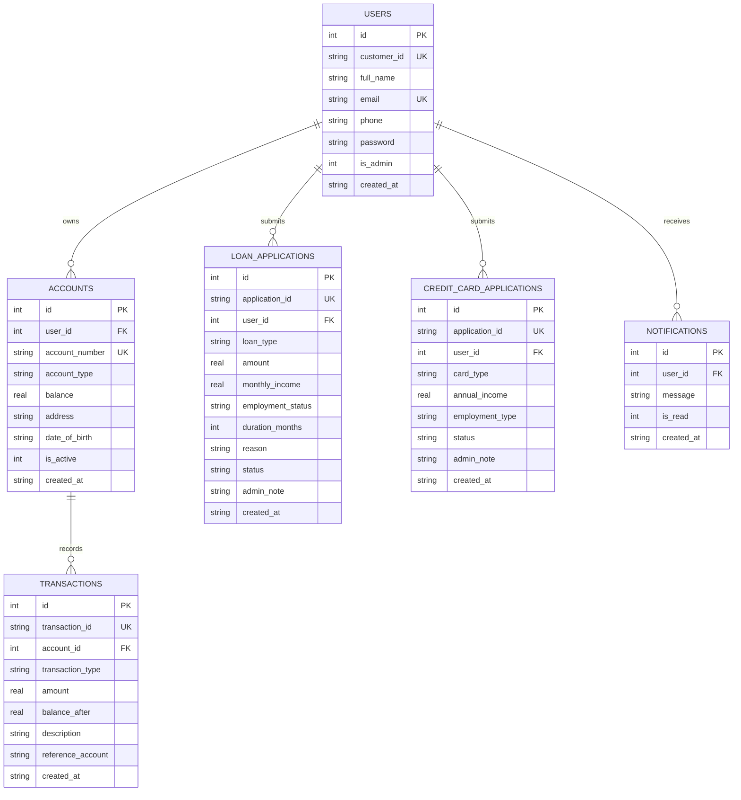

# 🏛️ KUBERA BANK – Smart Digital Banking System

> **"Your Wealth, Our Responsibility."**

A modern, full-stack college micro project designed as a realistic, secure, and intuitive digital banking platform. Built with **Python (Flask)**, **SQLite**, **Vanilla JavaScript**, **GSAP**, **Chart.js**, and **ReportLab**.

---

## 📋 Table of Contents
1. [Project Overview](#-project-overview)
2. [Key Features](#-key-features)
3. [Technology Stack](#-technology-stack)
4. [Project Structure](#-project-structure)
5. [Database Design](#-database-design)
6. [Installation & Setup](#-installation--setup)
7. [Default Credentials](#-default-credentials)
8. [Testing & Verification](#-testing--verification)
9. [Viva & Examination Q&A](#-viva--examination-qa)

---

## 🌟 Project Overview

**Kubera Bank** is a complete simulated digital banking system where users can register, open savings or current accounts, make deposits, withdrawals, and instant fund transfers, track transaction histories, apply for loans and credit cards, interact with a smart banking assistant, and download formal PDF statements.

The system also includes a dedicated **Admin Portal** allowing bank managers to review transactions, monitor total deposits, and approve or reject loan and credit card applications.

---

## 🚀 Key Features

### 1. 🎬 Cinematic Bank Entrance Experience
- **Smooth Logo Reveal**: Elegant brand introduction on page load.
- **GSAP & ScrollTrigger 2.5D Experience**: As users scroll on the homepage, the camera zooms into the bank exterior, the glass doors swing open in 3D perspective, revealing the warm bank interior and welcoming the user.
- **Interactive Financial Showcase**: Live animated counters, card previews, and services.

### 2. 🔐 Authentication & Profile Management
- Secure user registration and login with **Werkzeug password hashing**.
- Unique **Customer ID** generation (e.g., `KB20241234`).
- Automatic session protection and **CSRF token verification** on state-changing forms.
- Profile management with password change and contact updating.

### 3. 💳 Core Banking Operations
- **Account Opening**: Open either a **Savings Account** or a **Current Account** with an auto-generated 12-digit account number.
- **Deposit Money**: Real-time deposit processing with instant balance credit and notifications.
- **Withdraw Money**: Built-in validation ensuring accounts never go negative or breach transaction caps.
- **Fund Transfer**: Atomic transfer between any two Kubera Bank accounts using account numbers, debiting the sender and crediting the recipient with synchronized audit logs.
- **Transaction History**: Filter by transaction type (deposit, withdrawal, transfer) and date.

### 4. 📊 Smart Banking Features
- **Spending Analytics (Chart.js)**: Monthly financial visualizer contrasting incoming credits vs. outgoing debits.
- **Loan Applications**: Apply for *Personal Loans*, *Education Loans*, or *Home Loans* with a dynamic **Live EMI Calculator**.
- **Credit Card Applications**: Apply for *Classic*, *Gold*, or *Premium* cards with instant eligibility guidance.
- **Smart Assistant (Chatbot)**: A responsive rule-based banking assistant answering common banking queries without expensive external APIs.
- **PDF Bank Statements**: Download official statement documents formatted via **ReportLab**.
- **In-App Notifications**: Real-time event notifications for transactions, transfers, and application status changes.

### 5. 🛡️ Admin Dashboard
- Live overview of registered customers, accounts, total deposits, and transaction counts.
- Review pending loan applications and approve or reject with custom administrative remarks.
- Review pending credit card applications with instant customer notification.
- Global customer directory and transaction ledger.

---

## 🛠️ Technology Stack

| Layer | Technologies Used |
|---|---|
| **Frontend** | HTML5, CSS3, Modern JavaScript (ES6+), Bootstrap 5 (grid & utilities) |
| **Motion & Charts** | GSAP 3.12, ScrollTrigger, Chart.js 4.4, Font Awesome 6.5 |
| **Backend** | Python 3.8+, Flask Framework, Jinja2 Templates |
| **Database** | SQLite3 (Zero-configuration, lightweight relational database) |
| **PDF Generation** | ReportLab 4.0 |
| **Security** | Werkzeug Hashing, Session Management, CSRF Protection |

---

## 📂 Project Structure

```text
kuberabank/
│
├── app.py                     # Main Flask web application and all route controllers
├── config.py                  # Application settings, paths, and secrets
├── database.py                # SQLite table definitions and DB helper functions
├── requirements.txt           # Python library dependencies
├── run.py                     # One-click startup script with self-check
├── start.bat                  # Windows batch launcher
├── test_banking.py            # Complete automated test suite
├── README.md                  # Comprehensive project guide & viva notes
│
├── database/
│   └── kubera_bank.db         # Auto-generated SQLite database
│
├── templates/                 # Jinja2 HTML Templates
│   ├── base.html              # Master layout with responsive navbar & footer
│   ├── index.html             # Homepage with GSAP bank entrance scroll animation
│   ├── register.html          # User registration page with password strength
│   ├── login.html             # Secure login page
│   ├── dashboard.html         # Customer dashboard with balance card & Chart.js
│   ├── open_account.html      # Bank account opening form
│   ├── deposit.html           # Deposit funds page with quick buttons
│   ├── withdraw.html          # Withdrawal page with validation
│   ├── transfer.html          # Inter-account money transfer
│   ├── transactions.html      # History table with type and date filters
│   ├── loans.html             # Loan applications & live EMI calculator
│   ├── credit_cards.html      # Credit card selection & application
│   ├── profile.html           # Profile viewer & password management
│   ├── notifications.html     # Notification center
│   ├── admin_dashboard.html   # Admin management overview
│   ├── admin_customers.html   # Admin customer roster
│   └── admin_transactions.html# Admin global transaction log
│
└── static/
    ├── css/
    │   ├── style.css          # Core design system & theme variables
    │   └── dashboard.css      # Dashboard & admin responsive styling
    ├── js/
    │   ├── main.js            # Navbar, mobile menu, counters, and chatbot
    │   ├── animations.js      # GSAP intro & 2.5D bank entrance scroll
    │   └── dashboard.js       # Chart.js analytics & balance counter
    └── images/
        ├── logo.svg           # Royal Kubera Bank Vector Logo
        └── favicon.svg        # Browser tab favicon
```

---

## 🗄️ Database Design

The system employs normalized relational tables in SQLite with Foreign Key constraints enabled:



---

## ⚙️ Installation & Setup

### Prerequisites
- Python 3.8 or higher installed on your computer.

### Step 1: Open the Project Directory
```bash
cd kuberabank
```

### Step 2: Install Dependencies
```bash
pip install -r requirements.txt
```
*(Dependencies: Flask, Werkzeug, ReportLab)*

### Step 3: Run the Application
You can start the server using either:
- **Command Line**:
  ```bash
  python app.py
  ```
- **Helper Script**:
  ```bash
  python run.py
  ```
- **Windows Batch file**: Double-click `start.bat`.

### Step 4: Open in Your Browser
Visit: **[http://127.0.0.1:5000](http://127.0.0.1:5000)**

---

## 🔑 Default Credentials

### Administrator Portal
- **URL**: `http://127.0.0.1:5000/login`
- **Email**: `admin@kuberabank.com`
- **Password**: `kubera@admin2024`

### Standard Customer
- Register any new account through `/register` to test the full customer journey.

---

## 🧪 Testing & Verification

A dedicated test suite is included to verify all operations:
```bash
python test_banking.py
```
This tests:
1. Homepage rendering and brand presence
2. Admin initialization
3. User registration & Customer ID creation
4. Session login & authentication
5. Bank account opening
6. Cash deposit & balance increment
7. Overdraft prevention & cash withdrawal
8. Inter-account transfer between multiple accounts
9. Loan submission & admin approval workflow
10. Credit card review & admin workflow
11. Banking Chatbot API responses
12. Spending analytics API response

---

## 🎓 Viva & Examination Q&A

### Q1: Why did you choose SQLite for this project?
> **Answer**: SQLite is a serverless, self-contained, zero-configuration SQL database engine. For a college micro-project, it requires no external database server installations (unlike MySQL or PostgreSQL), stores data safely in a single portable file (`kubera_bank.db`), and supports standard SQL queries, ACID transactions, and foreign keys.

### Q2: How is password security handled?
> **Answer**: Plaintext passwords are never stored in the database. When a user registers, Werkzeug's `generate_password_hash()` creates a salted cryptographic hash (using pbkdf2/scrypt). During login, `check_password_hash()` verifies the entered password against the stored hash.

### Q3: How do you prevent negative balances or race conditions during money transfers?
> **Answer**: In `transfer()`:
> 1. We first validate that the sender's balance is greater than or equal to the transfer amount.
> 2. We execute both the sender debit and receiver credit within a single database transaction.
> 3. If any step fails, changes can be rolled back, ensuring financial consistency and preventing money from disappearing or duplicating.

### Q4: How is CSRF (Cross-Site Request Forgery) mitigated?
> **Answer**: A unique, random cryptographic token (`_csrf_token`) is generated in the user's session. Every HTML form contains a hidden field `<input type="hidden" name="csrf_token" value="{{ csrf_token() }}">`. On every POST request, Flask checks that the form token matches the session token before processing the request.

### Q5: How was the entrance animation created without heavy 3D engines?
> **Answer**: We used **GSAP (GreenSock Animation Platform)** with its **ScrollTrigger** plugin. Using CSS transforms (`scale()`, `translateY()`, `rotateY()`), we simulated a 2.5D camera zoom into a stylized architectural bank entrance with opening glass doors driven strictly by the user's scroll speed.
